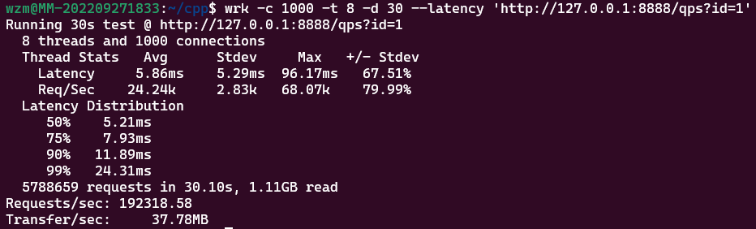

# CORPC - 基于协程的高性能 RPC 框架

[](https://en.wikipedia.org/wiki/C%2B%2B11)
[](LICENSE)

CORPC 是一款基于协程的异步 RPC 框架，使用 C++11 开发。核心协程库 [cppCo](https://github.com/GoblinsWang/cppCo) 为独立开源项目。

## 核心特性

- **高性能协程调度**：用户态协程切换，无内核开销
- **双协议支持**：HTTP/1.1 + Protobuf 自定义二进制协议
- **Reactor + 协程模型**：同步编程风格，异步执行效果
- **高性能网络**：基于 epoll 的非阻塞 I/O 多路复用
- **完整 RPC 功能**：服务注册、方法调用、客户端-服务器通信
- **内存优化**：对象池、内存池、无锁队列

## 性能测试

**HTTP echo 测试 QPS**

| 环境 | 配置 | QPS |
|------|------|-----|
| WSL | 12 核 | **19万+** |

测试工具：[wrk](https://github.com/wg/wrk.git)



## 快速开始

### 环境要求

- C++11 或更高版本
- CMake 3.6+
- Protobuf 3.x

### 编译

```bash
git clone https://github.com/GoblinsWang/corpc.git
cd corpc
mkdir build && cd build
cmake ..
make
```

### HTTP 服务器示例

```cpp
#include "tcp_server.h"
#include "http_servlet.h"

class HelloServlet : public corpc::HttpServlet {
public:
    void handle(corpc::HttpRequest* req, corpc::HttpResponse* res) override {
        res->setBody("Hello, CORPC!");
    }
};

int main() {
    auto addr = std::make_shared<corpc::IPAddress>("0.0.0.0", 8080);
    corpc::TcpServer server(addr, corpc::Http_Protocal);

    auto servlet = std::make_shared<HelloServlet>();
    server.registerHttpServlet("/hello", servlet);

    server.start();
    corpc::sche_join();
    return 0;
}
```

### PB RPC 服务器示例

```cpp
#include "tcp_server.h"
#include "your_service.pb.h"

class QueryServiceImpl : public QueryService {
public:
    void query_name(google::protobuf::RpcController* controller,
                    const QueryRequest* request,
                    QueryResponse* response,
                    google::protobuf::Closure* done) override {
        response->set_name("hello " + request->id());
        if (done) done->Run();
    }
};

int main() {
    auto addr = std::make_shared<corpc::IPAddress>("0.0.0.0", 8080);
    corpc::TcpServer server(addr, corpc::Pb_Protocal);

    auto service = std::make_shared<QueryServiceImpl>();
    server.registerService(service);

    server.start();
    corpc::sche_join();
    return 0;
}
```

## 协程 API

```cpp
namespace corpc {

// 启动一个新协程
// tid: -1 表示自动选择 Processor，否则指定 Processor ID
void co_go(std::function<void()> func, int tid = -1, size_t stackSize = 128*1024);

// 当前协程休眠指定毫秒
void co_sleep(int64_t interval);

// 等待调度器结束
void sche_join();

}
```

## 架构概览

```
┌─────────────────────────────────────────────────────────────────┐
│                     Application Layer                           │
│                  (HTTP Servlet / PB Service)                    │
└─────────────────────────────────────────────────────────────────┘
                              │
                              ▼
┌─────────────────────────────────────────────────────────────────┐
│                    TcpServer / TcpClient                        │
└─────────────────────────────────────────────────────────────────┘
                              │
                              ▼
┌─────────────────────────────────────────────────────────────────┐
│                      Scheduler (单例)                           │
│                   ┌─────┬─────┬─────┐                          │
│                   │ P0  │ P1  │ PN  │  (Processor per Thread)  │
│                   └─────┴─────┴─────┘                          │
│                         │                                       │
│                   ┌─────┴─────┐                                │
│                   │ Epoller   │  Timer  │  Coroutine Pool      │
│                   └───────────┴─────────┴──────────┘           │
└─────────────────────────────────────────────────────────────────┘
```

## 文档

- [架构设计文档](docs/architecture.md) - 详细的架构设计和实现原理

## 支持的协议

### 1. HTTP 协议
实现了基本的 HTTP/1.1 协议编解码，可快速搭建 RESTful 服务。

### 2. PB 协议
基于 Protobuf 的自定义二进制协议，更高效的数据传输：

```
┌─────────────────────────────────────────────────────────────┐
│ pk_len │ msg_req │ service_full_name │ err_code │ pb_data  │
└─────────────────────────────────────────────────────────────┘
```

## 目录结构

```
corpc/
├── corpc/              # 核心源代码
│   ├── coroutine/      # 协程模块（调度器、处理器、上下文切换）
│   ├── log/            # 日志模块
│   └── net/            # 网络模块
│       ├── http/       # HTTP 协议实现
│       ├── pb/         # Protobuf RPC 实现
│       └── tcp/        # TCP 连接管理
├── example/            # 示例代码
├── docs/               # 文档
└── README.md           # 项目说明
```

## 技术栈

| 组件 | 技术 |
|------|------|
| 协程切换 | x86_64 汇编 (来自腾讯 libco) |
| IO 多路复用 | epoll |
| 定时器 | timerfd + epoll |
| 序列化 | Protobuf |
| 线程模型 | N 个线程，每线程 M 个协程 |
| 并发控制 | 自旋锁、读写锁、无锁队列 |

## TODO

- [x] 时间轮算法
- [x] PB 及 RPC 实现
- [x] 应用 libco 中的上下文切换汇编代码
- [ ] 实现非阻塞异步的 RPC 调用
- [ ] 实现 m:n 协程，采用共享协程池的模式

## 致谢

- [libco](https://github.com/Tencent/libco) - 腾讯开源的协程库，提供了上下文切换的汇编实现
- [cppCo](https://github.com/GoblinsWang/cppCo) - 独立的协程库项目

## License

MIT License
